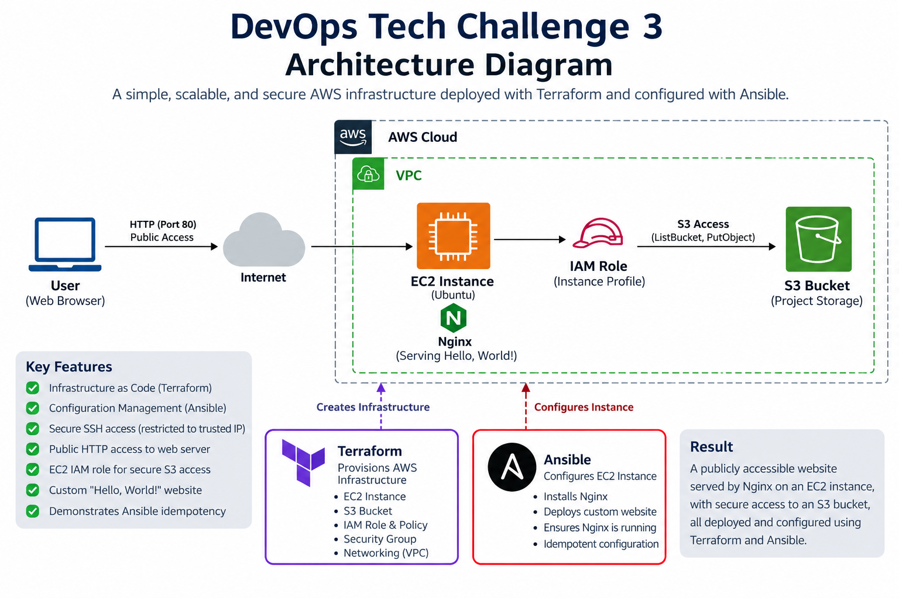
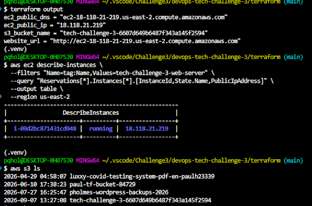
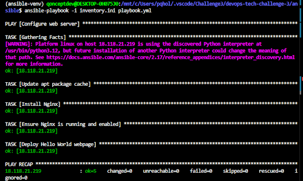
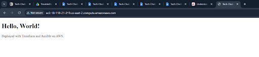
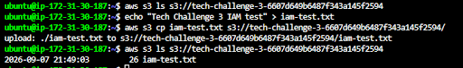

# DevOps Tech Challenge 3

## Project Overview

This project demonstrates Infrastructure as Code (IaC) and configuration management using Terraform and Ansible on AWS.

Terraform provisions the AWS infrastructure, including an EC2 instance, S3 bucket, IAM resources, and security groups. Ansible configures the EC2 instance, installs Nginx, and deploys a simple **"Hello, World!"** webpage.

## Architecture



The solution follows a dependency-first deployment approach:

**Terraform → AWS Infrastructure → SSH Validation → Ansible → Nginx → Public Website**

Terraform is responsible for creating the infrastructure, while Ansible is responsible for configuring the server after the infrastructure is available.

---

## Technologies Used

- AWS
- Terraform
- Ansible
- Amazon EC2
- Amazon S3
- AWS IAM
- AWS Security Groups
- Nginx
- Ubuntu
- WSL
- Git
- GitHub

---

## Project Structure

```text
devops-tech-challenge-3/
├── ansible/
│   ├── files/
│   │   └── index.html
│   ├── inventory.ini
│   └── playbook.yml
├── images/
│   ├── tc3_diagram.png
│   ├── website.png
│   ├── terraform-outputs.png
│   ├── ansible-idempotency.png
│   └── s3-iam-test.png
├── terraform/
│   ├── ec2.tf
│   ├── iam.tf
│   ├── main.tf
│   ├── networking.tf
│   ├── outputs.tf
│   ├── s3.tf
│   └── variables.tf
├── .gitignore
└── README.md
```

---

## Prerequisites

Before deploying the project, the following are required:

- AWS account
- AWS CLI configured with appropriate permissions
- Terraform
- WSL/Ubuntu
- Ansible
- Git
- Existing AWS EC2 key pair
- SSH private key available locally

Ansible was installed inside a Python virtual environment within WSL/Ubuntu to provide an isolated and compatible Ansible environment.

---

## Terraform Infrastructure

Terraform provisions the AWS infrastructure required for the project.

The configuration creates:

- Ubuntu EC2 instance
- S3 bucket
- IAM role and policy
- EC2 instance profile
- Security group
- HTTP ingress on port 80
- Restricted SSH ingress on port 22
- Outbound internet access

Terraform also retrieves the default AWS VPC and a current Ubuntu AMI for the EC2 instance.

### Terraform Deployment

Navigate to the Terraform directory:

```bash
cd terraform
```

Format, initialize, validate, and review the Terraform configuration:

```bash
terraform fmt
terraform init
terraform validate
terraform plan
```

Deploy the infrastructure:

```bash
terraform apply
```

View the Terraform outputs:

```bash
terraform output
```

Terraform provides the EC2 public IP, public DNS name, website URL, and S3 bucket name.

### Terraform Validation



The Terraform deployment was validated by confirming that the EC2 instance was running and the expected EC2, S3, IAM, security group, and networking resources were present.

---

## EC2 and SSH Validation

Before introducing Ansible, SSH connectivity to the Terraform-created EC2 instance was tested manually.

```bash
ssh -i ~/.ssh/TechCh_kp.pem ubuntu@<EC2-PUBLIC-IP>
```

This confirmed that:

- EC2 was publicly reachable
- Port 22 was accessible from the trusted IP address
- The SSH key pair worked
- The Ubuntu SSH user was correct
- The instance had outbound internet connectivity

Validating SSH independently helped separate infrastructure and networking issues from potential Ansible configuration issues.

---

## Ansible Configuration

Ansible runs from WSL/Ubuntu and connects to the EC2 instance over SSH.

### Inventory

The Ansible inventory identifies the EC2 instance and defines the SSH connection settings.

```ini
[webservers]
<EC2-PUBLIC-IP>

[webservers:vars]
ansible_user=ubuntu
ansible_ssh_private_key_file=~/.ssh/TechCh_kp.pem
```

The public IP should be updated if the EC2 instance receives a different address.

### Connectivity Test

Before running the configuration playbook, Ansible connectivity can be tested with:

```bash
ansible webservers -i inventory.ini -m ping
```

A successful response confirms that Ansible can communicate with the EC2 instance.

### Ansible Playbook

The playbook performs the complete web-server configuration:

```yaml
---
- name: Configure web server
  hosts: webservers
  become: true

  tasks:
    - name: Update apt package cache
      ansible.builtin.apt:
        update_cache: true
        cache_valid_time: 3600

    - name: Install Nginx
      ansible.builtin.apt:
        name: nginx
        state: present

    - name: Ensure Nginx is running and enabled
      ansible.builtin.service:
        name: nginx
        state: started
        enabled: true

    - name: Deploy Hello World webpage
      ansible.builtin.copy:
        src: files/index.html
        dest: /var/www/html/index.html
        owner: root
        group: root
        mode: "0644"
```

The playbook:

- Updates the Ubuntu package cache
- Installs Nginx
- Starts Nginx
- Enables Nginx at boot
- Deploys the custom webpage

Run the playbook with:

```bash
ansible-playbook -i inventory.ini playbook.yml
```

---

## Hello World Webpage

The custom webpage is stored at:

```text
ansible/files/index.html
```

The page contains:

```html
<!DOCTYPE html>
<html lang="en">
<head>
    <meta charset="UTF-8">
    <meta name="viewport" content="width=device-width, initial-scale=1.0">
    <title>Tech Challenge 3</title>
</head>
<body>
    <h1>Hello, World!</h1>
    <p>Deployed with Terraform and Ansible on AWS.</p>
</body>
</html>
```

Ansible copies this file to:

```text
/var/www/html/index.html
```

on the EC2 instance.

---

## Ansible Idempotency

The Ansible playbook was executed twice to verify idempotency.

The initial run configured the server and reported:

```text
ok=5 changed=3 unreachable=0 failed=0
```

The second run reported:

```text
ok=5 changed=0 unreachable=0 failed=0
```

The `changed=0` result confirms that Ansible recognized the server was already in the desired state and did not make unnecessary changes.



---

## Website Validation

The completed deployment was tested from both a web browser and the command line.

The webpage can be tested with:

```bash
curl http://<EC2-PUBLIC-IP>
```

The HTTP response can be checked with:

```bash
curl -I http://<EC2-PUBLIC-IP>
```

A successful deployment returns an HTTP `200 OK` response and serves the custom **"Hello, World!"** webpage.

### Public Website



The successful request path is:

**User → Internet → Security Group Port 80 → EC2 → Nginx → Hello World**

---

## IAM and S3 Validation

Terraform creates an IAM role and EC2 instance profile that allow the EC2 instance to interact with the project S3 bucket without storing AWS access keys on the server.

The IAM policy follows a least-privilege approach and allows the EC2 instance to:

- List the project S3 bucket
- Retrieve objects from the project bucket
- Upload objects to the project bucket

The EC2 identity can be verified with:

```bash
aws sts get-caller-identity
```

S3 access can be tested with:

```bash
aws s3 ls s3://<BUCKET-NAME>/
```

A test object was created and uploaded from EC2:

```bash
echo "Tech Challenge 3 IAM test" > iam-test.txt
aws s3 cp iam-test.txt s3://<BUCKET-NAME>/
```

The object was successfully listed from the bucket, confirming that the EC2 IAM role and S3 permissions were functioning correctly.



The validated access path is:

**EC2 → Instance Profile → IAM Role → IAM Policy → S3 Bucket**

---

## Security

Several security practices were incorporated into the project:

- SSH access on port 22 is restricted to a trusted public IP
- HTTP traffic is allowed on port 80 for public website access
- EC2 uses an IAM role instead of stored AWS credentials for S3 access
- S3 permissions are limited to the project bucket
- SSH private keys are excluded from Git through `.gitignore`
- Terraform state and local variable files are excluded from Git

---

## Deployment Workflow

1. Clone the GitHub repository.
2. Configure AWS CLI credentials.
3. Configure the required Terraform variables.
4. Run Terraform to provision the AWS infrastructure.
5. Retrieve the EC2 public IP from Terraform.
6. Update the Ansible inventory with the EC2 public IP.
7. Validate SSH and Ansible connectivity.
8. Run the Ansible playbook.
9. Open the Terraform-generated website URL.
10. Validate the webpage, Nginx, IAM, and S3 access.

---

## Cleanup

After testing is complete, the AWS resources can be removed using Terraform.

From the Terraform directory:

```bash
terraform destroy
```

Review the destruction plan and confirm when prompted.

This removes the Terraform-managed AWS infrastructure and prevents unnecessary AWS resource usage.

---

## Result

This project successfully demonstrates the use of **Terraform for Infrastructure as Code** and **Ansible for configuration management**.

Terraform creates the AWS infrastructure, including EC2, S3, IAM, and security resources. Ansible then connects to the EC2 instance, installs and configures Nginx, and deploys the custom webpage.

The final result is a publicly accessible **"Hello, World!"** website running on AWS with automated infrastructure provisioning, automated server configuration, least-privilege S3 access, and demonstrated Ansible idempotency.